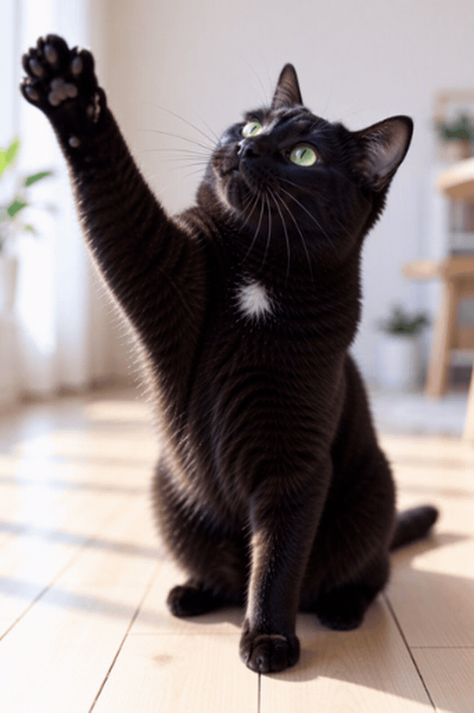
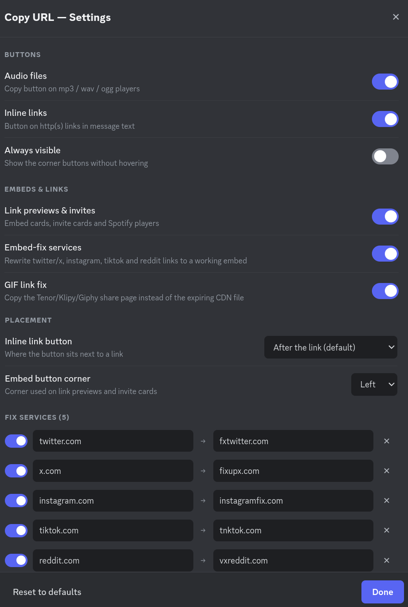

# discord-cpy-link

A userscript for Discord web that adds a one-click **copy** button to every image, video, sticker, audio file, link preview, invite and text link — and copies the full URL, CDN signature included, so it works when pasted into another channel, another server or a fresh browser tab.



## Why

Discord serves attachments through signed CDN URLs (`?ex=…&is=…&hm=…`). The usual workarounds fail in one of two ways: right-click → "Copy Image Link" gives you a thumbnail-sized WebP, and copying the URL without the signature gives a `403` anywhere else. This script resolves the original file (or the original page, for links) and puts it on your clipboard in one click.

## Features

- **Images and videos** — full-resolution original with its signature intact, including inside the media viewer.
- **Audio attachments** — the direct file URL from the player (mp3, wav, ogg, flac, …).
- **Stickers** — full-size sticker asset.
- **GIF embeds** — accepts inserts from Tenor, Klipy and Giphy: copies the provider's permanent share page (e.g. `https://klipy.com/gifs/…`) instead of the expiring CDN file.
- **Link previews, invite cards and Spotify players** — copies the destination link.
- **Inline links** — a small button appears at the end of any `http(s)` link in message text.
- **Embed-fix services** — rewrites `twitter.com`/`x.com`, `instagram.com`, `tiktok.com` and `reddit.com` links to a host that still renders a working embed (fxtwitter, fixupx, instagramfix, tnktok, vxreddit). Already-fixed links are left untouched, and the mapping is editable at runtime.
- **Settings dialog** — all features can be toggled from the userscript menu without touching code; values persist per browser profile.
- **No telemetry, no external API, no accounts.** The only network activity is the browser loading the media itself.

## Install

1. Install a userscript manager: [Tampermonkey](https://www.tampermonkey.net/), [Violentmonkey](https://violentmonkey.github.io/) or Greasemonkey.
2. Install the script from the raw file:

   ```
   https://raw.githubusercontent.com/DrScarab/discord-cpy-link/main/discord-fullsize-url.user.js
   ```

   Open that URL and confirm the install, or use "Install from URL" in your manager.
3. Reload Discord (`discord.com`).

Requires `discord.com` (or the legacy `discordapp.com`). Works in Chrome, Edge, Firefox and other Chromium/Firefox-based browsers.

## Usage

Hover a piece of media or a link; a small button appears in its corner. Click it and a toast confirms the copy.

| Target | Button position |
| --- | --- |
| Image, video, sticker | top-left corner of the media |
| GIF embed (Tenor/Klipy/Giphy) | top-left, below Discord's own favourite star |
| Audio player | top-left corner of the player |
| Link preview / invite / Spotify | top-left corner of the card |
| Inline link in text | just after the link text |

At the top-left of the media, a short click copies the URL. The button appears on hover and can be set to stay visible in the settings.

## Settings

Open the Tampermonkey menu and choose **Settings…**. The dialog is rendered in an isolated shadow root, so it looks the same regardless of your Discord theme.



- **Buttons** — enable or disable audio, inline-link and always-visible buttons.
- **Embeds & links** — link previews/invites, embed-fix services, GIF link fix.
- **Placement** — where the inline-link button sits (after the link, on its corner, or above it) and which corner the embed button uses.
- **Fix services** — edit the domain mappings (`from → to`), disable individual services, add new ones or remove dead ones. No code edits required when a service moves.

Everything applies immediately and is saved with `GM_setValue`.

## How it works

- Discord renders an invisible `a.originalLink` element over chat media. Its `href` is the pristine original file, so it is used when it points at the same attachment; otherwise the visible ``/`<video>` `src` is used and the unsigned thumbnail parameters (`width`, `height`, `format`, `quality`) are stripped while the signature stays intact.
- GIF embeds expose the provider's share page through the same overlay anchor, which is preferred over the short-lived CDN asset.
- Media, cards and players are located with stable DOM attributes where possible (message list items, media viewer, dialogs) rather than only hashed CSS class names.
- Buttons are plain absolutely-positioned elements placed inside the media container. If Discord re-renders or moves a container, the button verifies its own position and pins itself to the media instead of escaping to the page corner.
- All buttons are created by a single scanner driven by a `MutationObserver` plus scroll/resize hooks, so virtualised message lists work.
- Clipboard writes use `navigator.clipboard` with `GM_setClipboard` and a `textarea`/`execCommand` fallback.

## Notes and limitations

- Signed CDN links expire (the `ex=` parameter, typically around 24 hours). Copy them close to when you need them; there is no way to mint a new signature without Discord's client.
- Discord changes its markup regularly. The script is written defensively, but a major redesign can still require an update.
- The GIF feature performs a single image load to verify the `.gif` variant exists before falling back to the CDN file.
- Spoiler-covered media is not treated specially.

## Development

The whole script is one file, no build step:

```
node --check discord-fullsize-url.user.js
```

To test changes, paste the file into your userscript manager and reload Discord. Console messages are prefixed with `[Copy URL]`.

## AI assistance

This project was developed with AI assistance: the implementation was written
by an AI coding agent (OpenCode with a DeepSeek model) from the maintainer's
requirements, and every change was tested against the live Discord web client
before being committed. The maintainer is responsible for the code and for
reviewing contributions.

## License

MIT © 2026 DrScarab
